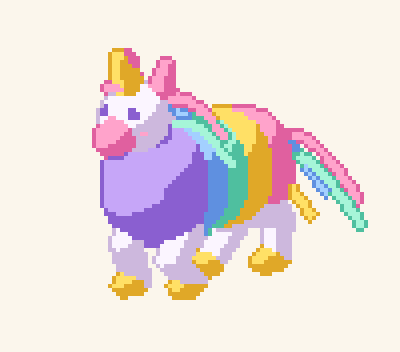

# Piñata

<p align="center">
  
</p>

Piñata is an experiment in AI-driven character animation. An AI agent describes a character as text (a mannequin of
simple volumes, materials, a behaviour script), and the tooling does what an AI finds hard to do by hand: physics,
inverse kinematics and secondary motion such as a cape swinging after a turn. Output is rendered as pixel art, with
numeric diagnostics and still images an agent can read to check its own work.

The repository is in a proof-of-concept phase. Each idea is proven in isolation against gates fixed before the code
was written, and visual quality is judged by blind, calibrated AI judge panels rather than by eye.

## Findings so far

| Proof | Question | Result |
|---|---|---|
| P1 static style | Can a procedural renderer turn a 3D mannequin into pixel art that passes as hand-made at 32-64px? | No. Readable and consistent across 8 directions, but blind judges picked the hand-made reference in 36 of 36 comparisons. |
| P2 pixel stability | Does the renderer stay stable in motion? | Yes, with temporal hysteresis (flicker under 1%). |
| P3 secondary motion | Does a simulated cape read as inertia, with materials and wind distinguishable by motion alone? | Yes. Gates pass, a rigid control fails them, judges ranked materials and read wind correctly every time. |
| P4 locomotion | Does a behaviour script compile into planted, non-sliding footsteps with IK legs? | Yes for the motion; not readable as small procedural pixel strips. |
| P5 AI authoring loop | Can a fresh AI agent author a character from a one-line prompt with only the guide and the check command? | Yes. Three characters passed every gate in 1-6 runs and judges matched each to its prompt. |
| P6 style swap | Is style independent of motion? | Yes. One character in three styles, judges grouped by character and by style without error. |
| Skins spike | Do AI-drawn per-part sprites look better than procedural rendering? | Promising: preferred in walk strips and rated more hand-made than CC0 references in 44 of 54 comparisons, but formally inconclusive. |

The working conclusion is that the value is in the motion engine (scripted locomotion, IK and secondary motion with
machine-checkable diagnostics, authored by AI), with per-part sprites as the visual layer. See `docs/ROADMAP.md`.

## Running it

Requires Node.js 24 or later; TypeScript runs directly through Node's type stripping, with no build step.

```bash
npm install
npm test            # unit tests
npm run typecheck   # tsc, no emit
npm run p1          # P1: render the knight in 8 directions, evaluate gates, write reports/p1/
npm run p3          # P3: simulate cape and plume in three scenarios per material, write reports/p3/
npm run p2          # P2, p4, p6 and skins likewise; see package.json
npm run check -- examples/knight   # check a character package (see docs/authoring.md)
npm run demo        # render the walking piñata demo (animated PNG and frames) to reports/demo/
npm run skins -- pocs/skins-spike/artist-skin.json   # render the knight with AI-drawn part sprites
npm run p1:verify   # same as p1 plus the determinism re-run; likewise p2:verify, p3:verify, p4:verify, p6:verify
```

Each proof-of-concept runner exits 0 when all gates pass, 1 when a gate fails and 2 when the harness itself fails,
and writes a `summary.txt`, `metrics.json` and still images to `reports/<poc>/`. P1 also writes `preview.html`.

The determinism check (the `nondeterministicFrames` gate) re-renders everything in a child process and roughly
doubles the run time, so it only runs with `--verify` (`npm run p1 -- --verify` or `npm run p1:verify`). Without it the
gate is reported as `SKIP` and the verdict reads `PASS (1 skipped)`, never a plain pass.

## Repository layout

- `src/`: the library, one directory per component (formats, raster, style, sim, motion, diagnostics).
- `pocs/`: one directory per proof of concept, with its assets, gates and runner.
- `examples/`: character packages: the knight, a four-legged dog, the piñata, and three characters authored by AI
  agents in P5 (rogue, dwarf, wizard).
- `docs/assets/`: the provisional logo (a hanging unicorn piñata, rendered with the engine).
- `test/`: unit tests.
- `refs/`: CC0 reference sprites used in the P1 judge panel, with sources in `refs/LICENSES.md`.
- `docs/plans/`: the viability design, the plan for each proof, findings logs and the judge panel artefacts.

## Further reading

- `docs/ROADMAP.md`: what the proofs showed and the plan for building the tool.
- `docs/authoring.md`: how to write a character package.
- `docs/plans/2026-10-30-viability-design.md`: requirements, components, proofs and the AI judge panel method.
- `docs/plans/*-findings.md`: every tuning run and judge result, per proof.

## Licence

MIT, see `LICENSE`. The reference sprites in `refs/` are CC0 works by their respective authors.
